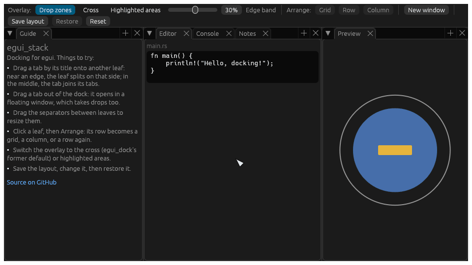

# `egui_stack`: docking for [egui](https://github.com/emilk/egui)

[](https://github.com/quazardous/egui_stack)
[](https://crates.io/crates/egui_stack)
[](https://docs.rs/egui_stack)
[](https://quazardous.github.io/egui_stack/)
[](https://github.com/emilk/egui)

`egui_stack` is a docking and window-layout system for `egui`: a window's whole space as a tree of zones (side
areas, a centre, toolbars), tabs in splits, rows, columns and grids inside them, folding and collapsing zones, floating
windows, and collapsible sections stacked in a panel.

**[Try it in your browser](https://quazardous.github.io/egui_stack/)**: the demo ([`demo/`](demo)), built for the web
from this repository's main branch.



## Features

**Docking**

- Tabs in splits, rows, columns and n-ary grids; opening, closing, moving and resizing them.
- Drop zones drawn on the target (a border and a light tint), with an edge band to split and a band under the tab bar
  to join; a tab lands where it is released.
- Dragging a single tab, or a whole tab group by a grip at the end of its tab bar, the empty part of the bar, a tab
  dragged with Shift held, or "Move group" in its menu, each handle switchable (`GroupHandles`); a drag starts only
  past an activation distance.
- Floating windows split gestures by where a drag starts: a tab, the group grip (or Shift), or the title bar and a
  move handle that moves the window, with the move cursor; moving a window only moves it, or docks it whole as in
  Visual Studio with `FloatMove::Dock`.
- Floating docks for tabs and groups dragged out: over the main window, or in native windows of their own (egui
  viewports the application hosts through `ViewportHost`), drawn by `FloatsArea`; closing one returns its tabs where
  they came from, or as `ClosePolicy` says, and windows left off every screen are brought back
  ([docs/native-floats.md](docs/native-floats.md)).
- One drag across native windows (`DockSpace::dragging`): a tab or a group goes from the main window to a float, back,
  or from float to float, with the same drop zones, veto and Escape, across screens of different scales; where the
  system hides window positions (Wayland), the windows that could take it are outlined.
- Several docks sharing one drag (`DockSpace`): side areas and a centre, each drawn where the application puts it,
  with no-drop zones (a toolbar, a status bar) where a released tab goes back instead of floating.
- A veto on every drop (`dock_drop_allowed`), and full control of the layout from code.

**Window layout** ([docs/layout-and-dock.md](docs/layout-and-dock.md))

- `layout::Layout`: the window as a tree of zones with constraints (least, largest and default sizes in points or
  shares), drawn by `LayoutArea`, with sashes that snap and resize from the keyboard.
- Folding a zone to a strip, with a grip, the app's icons and an optional built-in title (`LayoutStyle::strip_title`,
  or `ZoneViewer::strip_title` to draw it yourself); a click unfolds, a drag on the strip's edge pulls it out.
- Zones that fold by themselves for want of room (`Constraints::auto_fold`), reported as `LayoutEvent`s.
- Strips that take dropped tabs (`Constraints::strip_drops`), and empty docks that collapse to nothing
  (`Fold::Collapse`) and come back from a restore band while a tab is dragged.
- Zones lying over their neighbour and a flyout, with their own dismiss rules.
- `Docked`: a `Layout` and its `DockSpace` saved and repaired as one value (`serde` feature), floats included.
- An optional `bus` feature declaring egui_stack's points (`stack.dock.drop`, `stack.layout.changed`,
  `stack.window.*`) on an application's [bus-contract](https://docs.rs/bus-contract) bus.

**Sections**

- Collapsible sections stacked in a panel (`sections::Sections`): fold, resize, pull as a block, size by content or
  share, remembered by name.

**Look and access**

- A `Style`, or a `DockPainter` / `LayoutPainter` that paints tabs, tab bars, bodies, separators, strips, sashes and
  drop overlays itself.
- Every separator, sash, grip and strip is named for screen readers (`Labels`), and reachable from the keyboard.

## Quick start

Add `egui` and `egui_stack` to your project's dependencies:

```toml
[dependencies]
egui = "0.37"
egui_stack = "0.28"
```

Then proceed by setting up `egui`, following its [quick start guide](https://github.com/emilk/egui#quick-start). Once
that's done, you can start using `egui_stack`; its documentation builds with `cargo doc --open`.

## Examples

The Git repository of this crate contains some example applications demonstrating how to achieve certain effects. You
can find all of them in the [`examples`](examples) folder.

You can run them with Cargo from the crate's root directory, for example: `cargo run --example hello`.

`cargo run --example wgpu_float` shows a detached 3D viewport: a tab rendering its own wgpu scene moves into a native
floating window the application hosts ([docs/native-floats.md](docs/native-floats.md), "Using native floats").

## Demo

The demo, a separate crate in [`demo/`](demo), runs natively with `cargo run -p egui_stack_demo` and in the browser:
[`demo/build-web.sh`](demo/build-web.sh) builds it into `demo/dist`. The [online demo](https://quazardous.github.io/egui_stack/)
is rebuilt on each push to the main branch.

Its Inspect button (Ctrl+Shift+F12) picks a part of the dock (a tab, a tab bar, a body, a separator) and says what it is
and which `Style` fields drew it, with a Copy button for bug reports; a second view holds egui's own inspection.

## History and credits

`egui_stack` continues [`egui_dock`](https://github.com/anhosh/egui_dock): a docking system for `egui`, originally
created by [@lain-dono](https://github.com/lain-dono) and developed for years by
[Adam Gąsior (@Adanos020)](https://github.com/Adanos020), later maintained by [@anhosh](https://github.com/anhosh), with
many contributors. Its full history is kept here, so every commit keeps its author. Thanks to all of them.

It is a divergent fork: the API starts as `egui_dock` 0.21.1's, moved to egui 0.37, and will grow to hold more of an
application's panel management (stackable sections, toolbars). See [NOTICE](NOTICE) and the
[changelog](CHANGELOG.md).

What differs from `egui_dock`:

- The crate is `egui_stack`; `use egui_dock::` becomes `use egui_stack::`.
- egui 0.37.
- No particular policy on AI-assisted contributions: they are reviewed like any other, under the same rules (see
  [CONTRIBUTING.md](CONTRIBUTING.md)).
