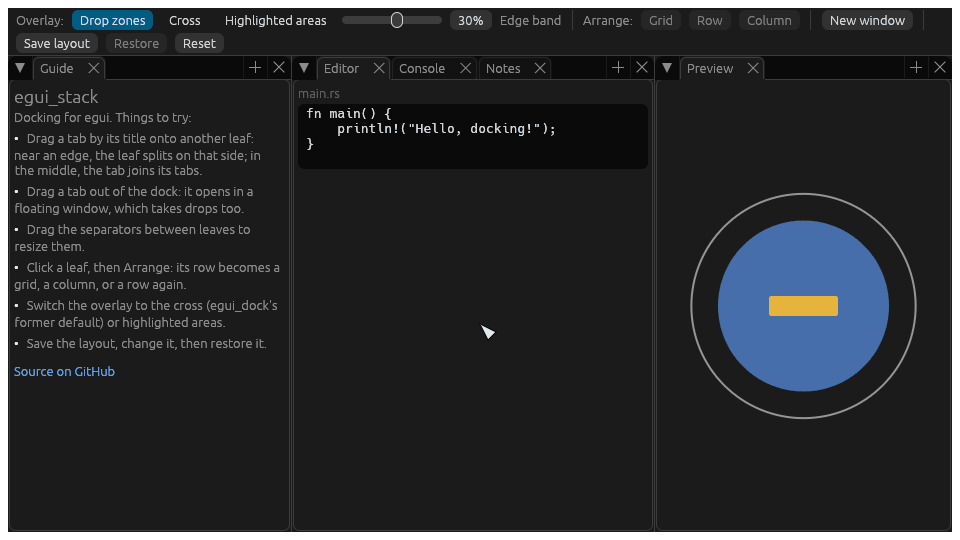

# `egui_stack`: docking for [egui](https://github.com/emilk/egui)

[](https://github.com/quazardous/egui_stack)
[](https://crates.io/crates/egui_stack)
[](https://docs.rs/egui_stack)
[](https://quazardous.github.io/egui_stack/)
[](https://github.com/emilk/egui)

`egui_stack` is a docking system for `egui`: tabs in splits, rows, columns and grids, floating windows, and
collapsible sections stacked in a panel.

**[Try it in your browser](https://quazardous.github.io/egui_stack/)**: the demo ([`demo/`](demo)), built for the web
from this repository's main branch.



## Features

- Opening and closing tabs.
- Moving tabs between nodes and resizing.
- Dragging tabs out into new `egui` windows.
- Several docks sharing one drag (`DockSpace`): side areas and a centre, each drawn where the application puts it,
  with the same drop zones between them as inside one dock, and no-drop zones (a toolbar, a status bar) where a released
  tab goes back instead of floating.
- Highly customizable look and feel: a `Style`, or a `DockPainter` that paints the tabs, tab bars, separators and drop
  overlay itself.
- High degree of control over behaviour of the whole dock area and of individual tabs.
- Manipulating tabs and dock layout from code.
- Collapsible sections stacked in a panel (`sections::Sections`): fold, resize, pull as a block, remembered by name,
  painted by the same `DockPainter`.

## Quick start

Add `egui` and `egui_stack` to your project's dependencies:

```toml
[dependencies]
egui = "0.37"
egui_stack = "0.25"
```

Then proceed by setting up `egui`, following its [quick start guide](https://github.com/emilk/egui#quick-start). Once
that's done, you can start using `egui_stack`; its documentation builds with `cargo doc --open`.

## Examples

The Git repository of this crate contains some example applications demonstrating how to achieve certain effects. You
can find all of them in the [`examples`](examples) folder.

You can run them with Cargo from the crate's root directory, for example: `cargo run --example hello`.

## Demo

The demo, a separate crate in [`demo/`](demo), runs natively with `cargo run -p egui_stack_demo` and in the browser:
[`demo/build-web.sh`](demo/build-web.sh) builds it into `demo/dist`. The [online demo](https://quazardous.github.io/egui_stack/)
is rebuilt on each push to the main branch.

Its Inspect button (Ctrl+Shift+F12) picks a part of the dock (a tab, a tab bar, a body, a separator) and says what it is
and which `Style` fields drew it, with a Copy button for bug reports; a second view holds egui's own inspection.

## History and credits

`egui_stack` continues [`egui_dock`](https://github.com/anhosh/egui_dock): a docking system for `egui`, originally
created by [@lain-dono](https://github.com/lain-dono) and developed for years by
[Adam Gąsior (@Adanos020)](https://github.com/Adanos020), later maintained by [@anhosh](https://github.com/anhosh), with
many contributors. Its full history is kept here, so every commit keeps its author. Thanks to all of them.

It is a divergent fork: the API starts as `egui_dock` 0.21.1's, moved to egui 0.37, and will grow to hold more of an
application's panel management (stackable sections, toolbars). See [NOTICE](NOTICE) and the
[changelog](CHANGELOG.md).

What differs from `egui_dock`:

- The crate is `egui_stack`; `use egui_dock::` becomes `use egui_stack::`.
- egui 0.37.
- No particular policy on AI-assisted contributions: they are reviewed like any other, under the same rules (see
  [CONTRIBUTING.md](CONTRIBUTING.md)).
